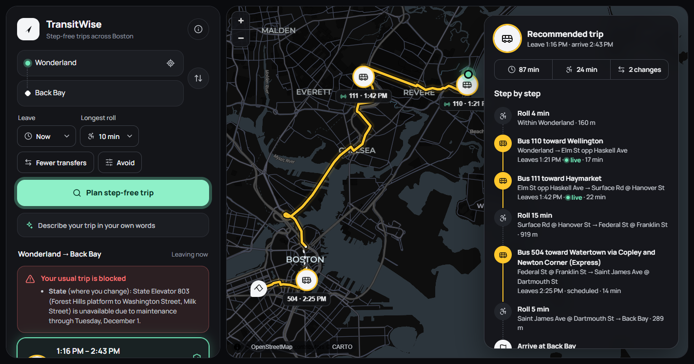
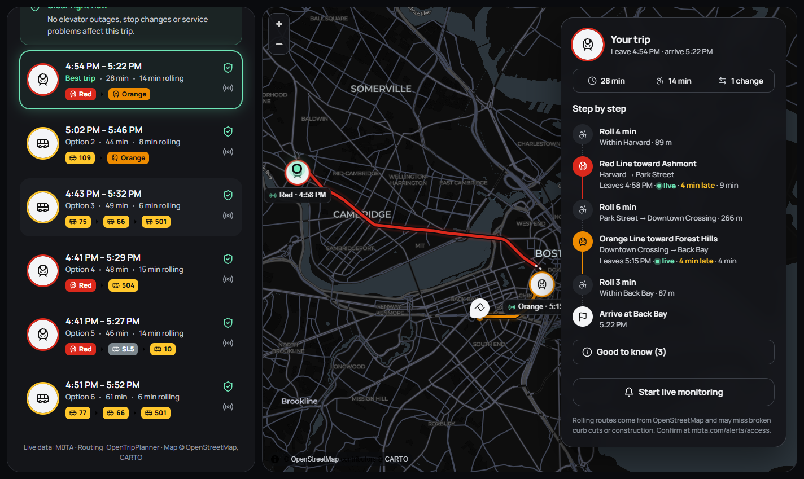
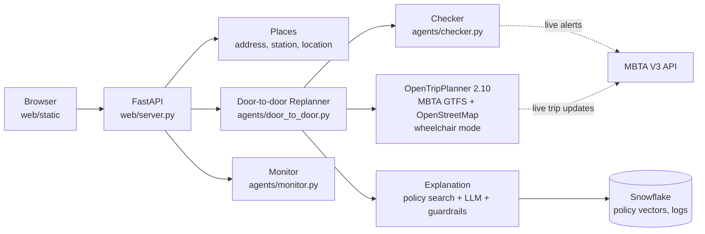

# TransitWise Boston

**Step-free, door-to-door trip planning for wheelchair users on the MBTA.**

Type a start and a destination (an address, a place, a station, or your current location).
TransitWise finds trips that combine rolling, buses, subway, Commuter Rail and ferries, using
only step-free paths. It checks every leg against live MBTA elevator and service alerts and
reroutes around problems before you leave.



## Why

General trip planners treat "accessible" as a fixed property of a station. In practice, an
elevator out of service on one platform can make a trip impossible for a wheelchair user, and the
rider usually only finds out on arrival. TransitWise plans with live elevator status, specific to
each platform, and explains what changed and why.

## What it does

- **Door-to-door trips**: rolling and transit legs, planned step-free by
  [OpenTripPlanner](https://www.opentripplanner.org/) with MBTA's in-station elevator paths.
- **Live checks**: every leg is checked against live MBTA alerts. That covers elevators on the
  platforms you board, leave or change at; suspensions on the stretch you ride; and closed or
  moved stops.
- **Automatic reroutes**: when the usual trip is blocked, it searches again without the line at
  fault and recommends the best safe trip.
- **Up to 6 choices**: different combinations of lines, with time, rolling minutes and
  transfers on each card, so the rider can pick.
- **Rider preferences**: longest single roll, fewer transfers, stations to avoid, leave now or
  later, or a plain-English request ("from my location to Fenway, avoid Kenmore, 5 minutes at a
  time").
- **Live monitoring**: while you travel, it watches live arrival times, missed connections,
  cancelled trips and new alerts, and replans from where you are.
- **Plain-English explanations**: an LLM explains the problem and the new trip, citing MBTA
  policy documents. Guardrails catch unsupported claims and fall back to a data-only answer.



## How it works



| Step | What happens | Code |
|---|---|---|
| Understand | Typed request → places and preferences | `agents/request_parser.py` |
| Find places | Station names, coordinates, or addresses (OpenStreetMap Nominatim) | `agents/places.py` |
| Plan | OpenTripPlanner in wheelchair mode, two search profiles, ranked so rolling counts double | `agents/otp.py` |
| Check | Platform-specific elevator checks and service changes per leg | `agents/checker.py` |
| Reroute | Follow-up searches without the route at fault | `agents/door_to_door.py` |
| Explain | Policy retrieval, LLM answer, citation and claim checks | `agents/door_to_door.py`, `agents/replanner.py` |
| Watch | Live times, missed connections, new alerts, replanning | `agents/monitor.py` |

More detail: [docs/door_to_door.md](docs/door_to_door.md) (planning, API, evaluation),
[docs/README.md](docs/README.md) (Snowflake data model) and [architecture.md](architecture.md).

## Results

A sweep of 300 random trips (2–12 km) with live data on 2026-11-13, measured before the
wheelchair-transfer fix:

| Measure | Result |
|---|---|
| Trips with a step-free option | 100% |
| Usual trips hit by a live problem | 5% (13 elevator outages, 3 suspensions); all rerouted |
| Median trip | 58 min, 13 min rolling, 2 transfers |
| Using live (not scheduled) times | 96% |
| Planning time | 0.27 s median (without the LLM explanation) |

## Tech stack

- **Routing**: OpenTripPlanner 2.10 (Docker), MBTA GTFS and GTFS-Realtime, OpenStreetMap
- **Backend**: Python 3.12, FastAPI, NetworkX (station-level planner)
- **Frontend**: HTML/CSS/JS, MapLibre GL, CARTO dark basemap
- **Data**: Snowflake (RAW/CLEAN/RAG schemas, key-pair auth), GitHub Actions alert pipeline
  every 30 minutes
- **AI**: Claude API for explanations and request parsing; sentence-transformers (MiniLM)
  embeddings for policy search
- **Tooling**: pytest (offline, on recorded OTP answers and real alerts), MCP server for agent
  tools

## Getting started

### Prerequisites

- Python 3.12
- Docker, with about 8 GB of memory for OpenTripPlanner
- A free [MBTA V3 API key](https://api-v3.mbta.com)
- Optional: a Claude API key (explanations) and a Snowflake account (policy search, logs,
  pipeline). Without them, the website still plans and checks trips and shows data-only
  explanations.

### 1. Install

```bash
git clone https://github.com/monu4959/Boston__Transit_MBTA.git
cd Boston__Transit_MBTA
python -m pip install -r requirements.txt
cp .env.example .env        # then fill in your keys
```

On Windows, use `py -3.12` in place of `python`.

### 2. Set up the database (optional)

Run `sql/01_setup.sql` in Snowflake (it creates the warehouse, role, and key-pair user), then:

```bash
python pipeline/build_db.py   # creates TRANSITWISE_DB: stations, platforms, elevators, policy chunks + embeddings
```

### 3. Start the route planner

```bash
python otp/setup_otp.py all       # first time: download MBTA + OpenStreetMap data, build, serve (~5 min)
python otp/setup_otp.py refresh   # weekly: new MBTA timetable, rebuild, restart
python otp/setup_otp.py stop      # free the memory when you're done
```

Data is stored outside the repo in `~/transitwise-otp` (change with `OTP_DATA_DIR`).

### 4. Run the website

```bash
python -m uvicorn web.server:app --port 8000
```

Open http://localhost:8000. "Use my location" works on localhost or over HTTPS.

## Tests

```bash
python -m pytest tests                  # offline: recorded OTP answers + real alerts, no API calls
TW_OTP=1 python -m pytest tests         # also hits the running OTP server
python tests/make_otp_fixtures.py       # re-record trips (needs OTP running)
python otp/sweep_door_to_door.py 300    # evaluate 300 random trips on today's live data
```

## MCP server

`mcp_server.py` exposes the agents as tools for MCP clients such as Claude Desktop:
`plan_door_to_door`, `plan_route`, `check_route`, `get_accessibility_alerts`, and
`search_mbta_policy`.

## Project layout

```
agents/      planning, checking, rerouting, monitoring, places, LLM
web/         FastAPI server and the static website
otp/         OpenTripPlanner setup, config, extra step-free transfers, evaluation sweep
pipeline/    Snowflake database build and the 30-minute alert loader
sql/         Snowflake setup and CLEAN views
policy_docs/ MBTA accessibility and shuttle policy PDFs (indexed for search)
tests/       offline tests and recorded fixtures
docs/        data model, door-to-door details, screenshots
app.py       earlier Streamlit app (station to station and door to door)
```

## Known limits

- Rolling routes come from OpenStreetMap and may miss broken curb cuts, construction or steep
  sidewalks.
- Trips planned for later are checked against the alerts active now.
- OpenTripPlanner can leave out whole routes, not single stops, so some reroutes are longer
  than needed.
- At Downtown Crossing, MBTA's data has no step-free path between some Red and Orange Line
  platforms. `otp/extra_pathways.csv` treats those transfers as working; this is an
  assumption, not MBTA data.

## Data and credits

- Transit data: [MBTA V3 API and GTFS](https://www.mbta.com/developers). TransitWise is not
  affiliated with or endorsed by the MBTA.
- Map data © [OpenStreetMap](https://www.openstreetmap.org/copyright) contributors; basemap
  © [CARTO](https://carto.com/attributions).
- Routing: [OpenTripPlanner](https://github.com/opentripplanner/OpenTripPlanner).

> **Before you travel**, confirm elevator status at
> [mbta.com/alerts/access](https://www.mbta.com/alerts/access). If no step-free trip works,
> [The RIDE](https://www.mbta.com/accessibility/the-ride) may be an option for eligible riders.
