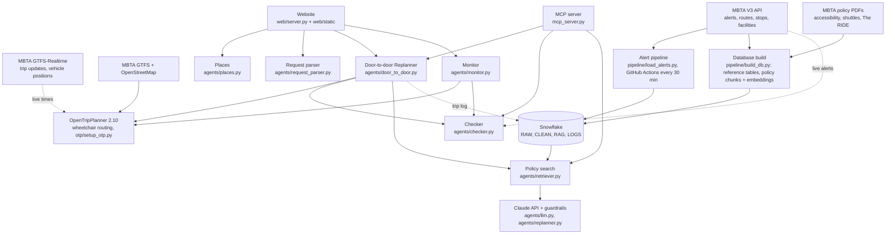

# TransitWise Boston: Architecture

## System architecture

The station-to-station planner (`agents/planner.py`, a NetworkX graph built from the Snowflake
tables) came first. It still backs the MCP `plan_route` and `check_route` tools and the older
Streamlit app in `streamlit_app/`; the website plans door to door with OpenTripPlanner.

## Data architecture

| Layer | Components |
|---|---|
| Sources | MBTA V3 API; MBTA GTFS and GTFS-Realtime; OpenStreetMap; MBTA policy PDFs in `policy_docs/` |
| Ingestion | `pipeline/load_alerts.py` (GitHub Actions, every 30 minutes); `pipeline/build_db.py` for reference tables and policy chunks; `otp/setup_otp.py` for the routing graph |
| Storage | Snowflake `TRANSITWISE_DB`: `RAW` (as loaded), `CLEAN` (SQL views), `RAG` (policy chunks with embeddings), `LOGS` (one row per planned trip) |
| Consumption | Website, Door-to-door Replanner, Checker, Monitor, policy search; MCP tools |

The data model is in [docs/README.md](README.md).
